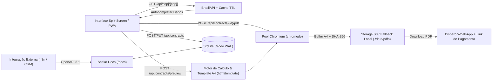

<div align="center">

<h1>IA Infinito — Gerador de Contratos</h1>
<p><strong>Motor de emissão, pré-visualização A4 em tempo real, auditoria e gestão de contratos de prestação de serviços em Go.</strong></p>

<p>
  
  
  
  
  
  
  
  
</p>

<br>

<table>
  <tr>
    <td align="left" width="33%">
      <strong>O que é</strong><br>
      Aplicação web e API REST em Go (<code>Golang 1.22+</code>) de binário único (<code>embed.FS</code>) para emissão, auditoria e gestão de contratos de prestação de serviços da IA Infinito.
    </td>
    <td align="left" width="33%">
      <strong>O que faz</strong><br>
      Integra consulta cadastral automática via CNPJ, cálculo silencioso de parcelamento com repasse líquido, pré-visualização A4 fiel em tempo real (<em>Split-Screen</em>), persistência em SQLite (WAL), backup em S3, suporte a PWA e envio automatizado via WhatsApp com link de pagamento.
    </td>
    <td align="left" width="33%">
      <strong>Resultado esperado</strong><br>
      Redução do tempo de fechamento comercial de minutos para segundos, zero erros de digitação cadastral ou matemática financeira e PDFs padronizados prontos para assinatura digital.
    </td>
  </tr>
</table>

</div>

---

## Fluxo de Funcionamento e Arquitetura



---

## Arquitetura e Stack

- **Binário Único (`//go:embed`):** Todos os templates HTML (`web/templates/contract_v1.html`), interface web (`web/index.html`), manifesto PWA (`web/manifest.webmanifest`, `web/sw.js`, ícones) e especificação OpenAPI (`web/openapi/openapi.yaml`) são compilados dentro do executável Go.
- **SQLite em Modo WAL sem CGO (`modernc.org/sqlite`):** Driver 100% Pure Go com `PRAGMA journal_mode = WAL`, `busy_timeout = 5000` e migrations automáticas idempotentes na inicialização.
- **Design System (Liquid Glass Estabilizado):** Interface dividida (*Split-Screen*) com tema Escuro (padrão) e Claro, casca externa translúcida + placa interna estabilizada (`@supports not` e `prefers-reduced-transparency` com fallback sólido), *Skeleton Loaders* com zero *layout shift* e responsividade mobile em abas (`<= 900px`).
- **Motor PDF (`chromedp`):** Pool persistente de abas headless renderizando o mesmo HTML da pré-visualização em papel A4 (`@page`), com cabeçalho oficial da **IA Infinito** e paginação em todas as páginas.

### Estrutura de Diretórios

```text
├── cmd/server/main.go             # Entrypoint HTTP e graceful shutdown
├── internal/
│   ├── config/                    # Variáveis de ambiente (.env) e dados da Contratada
│   ├── database/                  # Conexão SQLite (WAL) e migrations
│   ├── domain/                    # Regras de negócio, validações CNPJ/CPF, BRL/extenso e gross-up
│   ├── handler/                   # Rotas REST, UI, PWA e Scalar (/docs)
│   ├── repository/                # Persistência e busca no SQLite
│   └── service/                   # BrasilAPI, html/template, pool chromedp e S3/Local
├── web/                           # UI Split-Screen, PWA, templates e OpenAPI 3.1
├── docs/                          # Documentação de arquitetura, design system e progresso
├── Dockerfile                     # Build multi-stage (Go + Alpine + Chromium)
├── docker-compose.yml             # Orquestração da aplicação
└── .env.example                   # Modelo de variáveis de ambiente
```

---

## Endpoints da API & Scalar

A documentação interativa completa (OpenAPI 3.1) está disponível em **`/docs`** (via **Scalar**).

| Método | Rota | Descrição |
| :--- | :--- | :--- |
| `GET` | `/` | Interface web *Split-Screen* e PWA |
| `GET` | `/docs` | Documentação interativa **Scalar** (OpenAPI 3.1) |
| `GET` | `/health` | Status do SQLite, provedor de armazenamento e pool Chromium |
| `GET` | `/manifest.webmanifest` | Manifesto PWA instalável |
| `GET` | `/api/cnpj/{cnpj}` | Consulta dados cadastrais na BrasilAPI (com cache e fallback) |
| `POST` | `/api/contracts/preview` | Compila o HTML do contrato para pré-visualização A4 |
| `POST` | `/api/contracts` | Cria um novo contrato no SQLite |
| `GET` | `/api/contracts` | Lista e busca contratos (`?q=razao_ou_cnpj`) |
| `GET` | `/api/contracts/{id}` | Retorna os detalhes de um contrato salvo |
| `PUT` | `/api/contracts/{id}` | Atualiza um contrato existente |
| `POST` | `/api/contracts/{id}/pdf` | Gera o PDF A4 e salva no S3 ou em `./data/pdfs` |
| `GET` | `/api/contracts/{id}/pdf` | Baixa o PDF gerado (stream ou Presigned URL S3) |

---

## Como Executar

### 1. Localmente (Go 1.22+)

Copie o arquivo de exemplo de variáveis (opcional — sem S3 configurado, o sistema usa `./data/pdfs` automaticamente):

```bash
cp .env.example .env
```

Execute os testes e inicie o servidor:

```bash
go vet ./...
go test -v ./...
go run ./cmd/server
```

Acesse `http://localhost:8080` (Interface Web) ou `http://localhost:8080/docs` (Scalar API Docs).

### 2. Via Docker

```bash
docker build -t ia-infinito-contracts:latest .
docker run -d -p 8080:8080 -v $(pwd)/data:/app/data --name contratos-ia ia-infinito-contracts:latest
```

### 3. Deploy Automatizado (GitHub Actions + GHCR + Coolify + MinIO S3)

O pipeline em `.github/workflows/publish-coolify-image.yml` executa `go vet` e `go test`, constrói a imagem `linux/amd64` (`ghcr.io/joel299/gerador-contrato:coolify` e `sha-<commit>`) e aciona o webhook do Coolify usando `docker-compose.coolify.yml`, que já sobe a stack completa (`app` + `minio` + `minio-init`):

- **Porta interna:** `8080` (sem proxy Traefik próprio; gerenciado pelo Coolify).
- **MinIO S3 integrado:** no painel do Coolify, basta definir **`MINIO_ROOT_USER`** (ex.: `admin_iainfinito`) e **`MINIO_ROOT_PASSWORD`** (mínimo 8 caracteres). O container `minio-init` cria automaticamente o bucket `contratos` (ou `S3_BUCKET`) e conecta o `app` via `http://minio:9000` com `S3_USE_PATH_STYLE=true`.
- **Imagens do MinIO:** `pgsty/silo` e `pgsty/mc` (fork comunitário). O repositório `minio/minio` saiu do Docker Hub e faz o pull falhar com *access denied*.
- **Domínio:** vinculado ao serviço `app` na porta interna `8080` com HTTPS pelo Coolify. Antes de adicionar o domínio, crie o registro DNS **A** apontando para o IP do servidor. Defina `APP_BASE_URL` com a URL pública para referência.
- **Variáveis obrigatórias no Coolify:** `MINIO_ROOT_USER`, `MINIO_ROOT_PASSWORD`, `S3_BUCKET`, `S3_REGION`, `S3_USE_PATH_STYLE`, `APP_BASE_URL` e `DEFAULT_PAYMENT_LINK`.
- **Volumes persistentes:** `gerador_contrato_data:/app/data` (SQLite WAL) e `gerador_contrato_minio_data:/data` (PDFs no MinIO).
- **Secrets no GitHub Actions:** `COOLIFY_DEPLOY_WEBHOOK` e `COOLIFY_DEPLOY_TOKEN`.

---

## Licença

Distribuído sob a licença **MIT**. Consulte o arquivo [LICENSE](./LICENSE) para mais detalhes.
